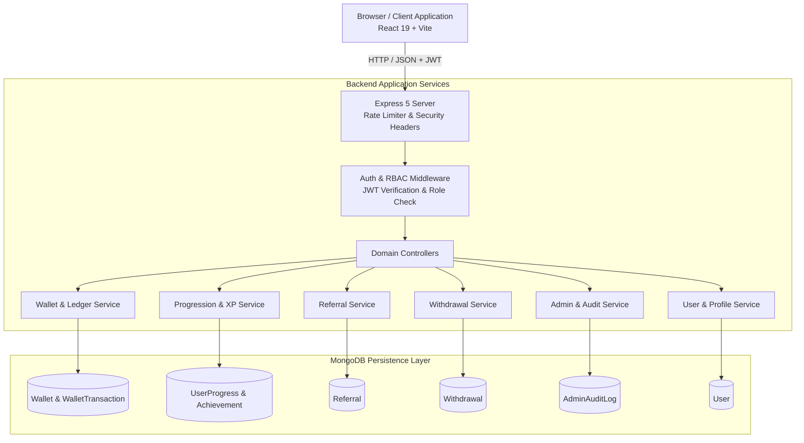
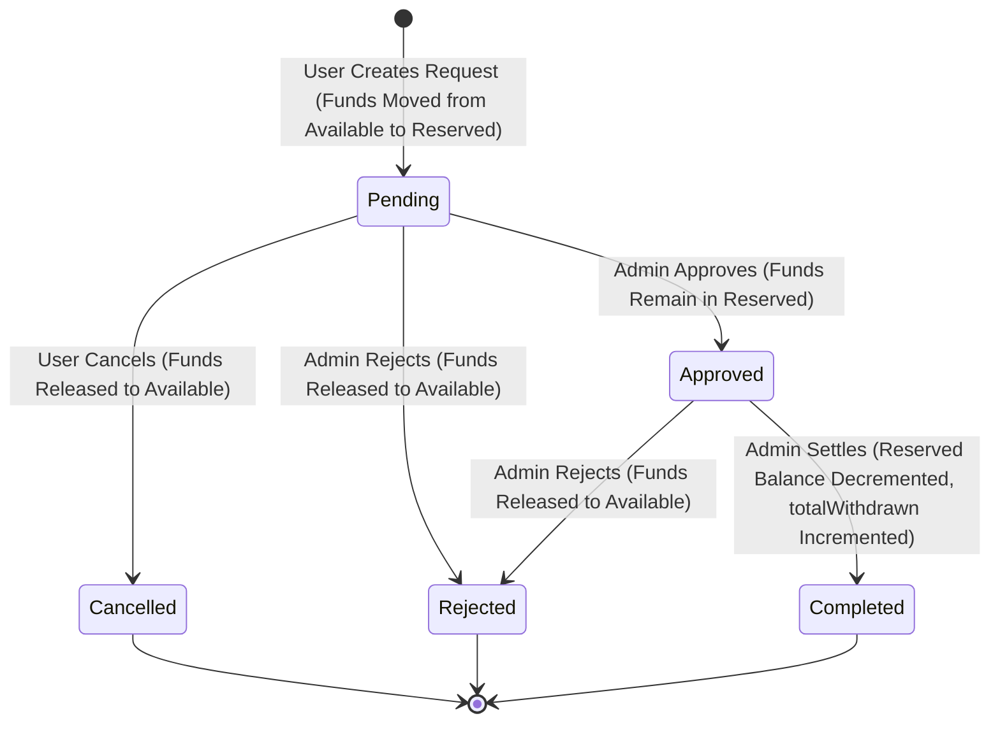

# VE Loop Rewards — System Architecture & Data Design

This document details the software architecture, database design, and key execution flows of the **VE Loop Rewards — Task 14 Full-Stack User Profile & Admin Management System**.

---

## 1. High-Level Architecture

The platform follows a decoupled, client-server architecture built on the MERN stack:
- **Presentation Layer (Frontend):** React 19 + Vite + Bootstrap 5 + CSS Modules. Communicates with the backend exclusively via an authenticated JSON REST client.
- **Application Layer (Backend):** Node.js 18+ + Express 5. Implements server-side authentication, role-based authorization, rate limiting, distributed request tracing (`X-Request-Id`), and domain business logic.
- **Persistence Layer (Database):** MongoDB + Mongoose ODM. Enforces schema validation, unique indexes, immutable audit hooks, and two-phase compensating transactions for financial accuracy.

---

## 2. Database Models & Schema Design

### 1. User Model (`User.js`)
- Primary identity entity.
- Fields: `name`, `email` (unique, lowercase), `password` (bcrypt hashed, `select: false`), `role` (`user` | `admin`), `status` (`active` | `suspended` | `inactive`), `referralCode` (sparse unique index), timestamps.
- Methods: `comparePassword(candidatePassword)`, `toSafeObject()` (removes hash).

### 2. Wallet Model (`Wallet.js`)
- Exactly one wallet per user (`userId` has a unique index).
- Balances stored as integer point units:
  - `VE`: `{ available, reserved, totalEarned, totalWithdrawn }`
  - `SVE`: `{ available, reserved, totalEarned, totalWithdrawn }`
  - `GEM`: `{ available, reserved, totalEarned, totalWithdrawn }`
  - `TOKEN`: `{ available, reserved, totalEarned, totalWithdrawn }`
- Enforces non-negative available and reserved values via Mongoose schema validators.

### 3. WalletTransaction Model (`WalletTransaction.js`)
- Append-only, immutable transaction ledger.
- Fields: `userId`, `walletId`, `assetType`, `type` (`CREDIT` | `DEBIT` | `HOLD` | `RELEASE` | `SETTLE`), `amount` (signed integer), `balanceBefore`, `balanceAfter`, `reason`, `referenceType`, `referenceId`, `idempotencyKey` (unique index), `actor`.
- Immutability: Pre-hooks on `updateOne`, `updateMany`, `deleteOne`, `deleteMany`, and `findOneAndUpdate` strictly reject mutations.

### 4. Progression Models (`UserProgress.js`, `LevelConfiguration.js`, `XpTransaction.js`)
- `UserProgress`: Stores `currentXp`, `currentLevel`, `totalXpEarned` with a unique index on `userId`.
- `LevelConfiguration`: Defines tier levels (1 to 7), tier titles (Novice, Bronze Explorer, Silver Adventurer, Reward Explorer, Gold Champion, Platinum Elite, Diamond Master), min XP thresholds, badges, and descriptions.
- `XpTransaction`: Immutable append-only audit trail for every XP credit.

### 5. Achievement Models (`Achievement.js`, `UserAchievement.js`)
- `Achievement`: Catalog of available platform achievements, codes (`ACH_WELCOME`, `ACH_BRONZE_HUNTER`), title, description, category, and criteria (`XP_THRESHOLD`, `CUSTOM`).
- `UserAchievement`: Per-user unlock and claim tracker. Compound unique index `{ userId: 1, achievementId: 1 }`. `unlocked: Boolean`, `unlockedAt: Date`, `isClaimed: Boolean`, `claimedAt: Date`.

### 6. Referral Model (`Referral.js`)
- Relationship between `referrerId` and `referredUserId`.
- Crucial Constraint: `referredUserId` has a unique index (ensuring exactly one referral per referred user) and a validation check preventing self-referrals (`referrerId !== referredUserId`).
- Status State Machine: `pending` -> `qualified` -> `rewarded` or `rejected`. Tracks historical transitions in `statusHistory`.

### 7. Withdrawal Model (`Withdrawal.js`)
- Tracks user payout requests.
- Fields: `userId`, `withdrawalId` (`WD-timestamp-hex`), `amount`, `assetType`, `payoutMethod` (`UPI`, `BANK_TRANSFER`, `CRYPTO`, `MANUAL`), `payoutDetails`, `status` (`pending`, `approved`, `completed`, `rejected`, `cancelled`), `idempotencyKey` (unique), timestamps.
- Fund Reservation: References `holdTransactionId`, `releaseTransactionId`, and `settleTransactionId`.

### 8. AdminAuditLog Model (`AdminAuditLog.js`)
- Tamper-proof platform audit trail.
- Fields: `action` (`USER_STATUS_CHANGE`, `WITHDRAWAL_APPROVE`, `WITHDRAWAL_REJECT`, `WITHDRAWAL_SETTLE`, etc.), `actor` (`adminId`, `email`, `role`), `target` (`targetType`, `targetId`), `reason`, `ipAddress`, timestamps.
- Protected by Mongoose immutability pre-hooks.

---

## 3. Core Architectural Service Flows

### 1. Two-Phase Compensating Ledger Protocol
When operating on MongoDB standalone topologies (where multi-document ACID transactions are unsupported):
1. **Idempotency Gate:** Checks if `idempotencyKey` exists in `WalletTransaction`. If found, immediately returns the existing transaction without mutating balances.
2. **Conditional Atomic Update:** Executes `findOneAndUpdate` with a balance check (`balances.VE.available: { $gte: amount }`). MongoDB's document-level lock guarantees atomic verification and modification, eliminating race conditions.
3. **Ledger Write:** Saves the new `WalletTransaction`.
4. **Compensating Reversal:** If step 3 encounters a database or network error, a compensating reversal query runs immediately in the `catch` block to restore the debited or credited funds, guaranteeing ledger-to-wallet agreement.

### 2. Withdrawal Lifecycle & Fund Reservation

### 3. Unified Profile Overview (`GET /api/users/me/overview`)
To ensure optimal performance and eliminate the "waterfall of API calls" problem:
- Executes 7 parallel MongoDB queries via `Promise.all`:
  1. `User.findById(userId)`
  2. `getOrCreateWallet(userId)`
  3. `getUserProgressionOverview(userId)`
  4. `getUserAchievements(userId)`
  5. `getUserReferralSummary(userId)`
  6. `getUserWithdrawalSummary(userId)`
  7. `WalletTransaction.find({ userId }).sort({ createdAt: -1 }).limit(10)`
- Returns a single consolidated payload rendering the entire dashboard in a single round-trip.

---

## 4. Frontend Component & State Architecture

- **State Management:** React Context (`AuthProvider`) encapsulates authentication tokens, current user session, and login/register/logout actions. Tokens persist in `localStorage` and synchronize with the API client.
- **Styles & Modularity:** CSS Modules (`.module.css`) isolate component styles, preventing CSS leakage. Global themes use CSS Custom Properties (`--bg-navy-dark: #0a1128`, `--text-light: #f8fafc`).
- **Responsive Layout:** Bootstrap 5 grid provides fluid responsiveness across mobile (375px+), tablet (768px+), and desktop (1024px+).
- **Graceful UI States:** Every dynamic view includes skeleton loading indicators, empty-state placeholders, and clear error banners with retry triggers.
